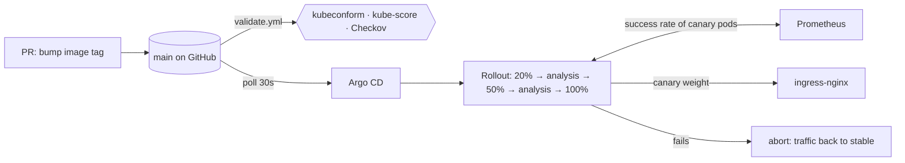

# GitOps & Safe Rollback on Kubernetes

A case study in GitOps delivery and release safety. Argo CD syncs a local
`kind` cluster from this repository, Argo Rollouts ships a demo app through
canary steps behind ingress-nginx, and a Prometheus analysis aborts a bad
release automatically. The repo then compares the ways of rolling back
(abort, in-cluster undo, `git revert`) and records what each one actually did.

**Stack:** Kubernetes (kind) · Argo CD · Argo Rollouts · Helm · ingress-nginx ·
Prometheus · GitHub Actions · kubeconform · kube-score · Checkov



More in [docs/ARCHITECTURE.md](docs/ARCHITECTURE.md).

## Results

Every number comes from a recorded run; the evidence column links the raw,
timestamped output. Narrative: [docs/case-study/SCENARIOS.md](docs/case-study/SCENARIOS.md).

| Scenario | Outcome | Measured | Evidence |
|---|---|---|---|
| A. Good release v1 → v2 | Both analyses passed, promoted to 100% | 247s push → fully promoted | [A](docs/evidence/scenario-a/good-release-v1-to-v2.txt) |
| B. Bad release v2 → v3.0.0-bad (~40% HTTP 500) | Analysis failed (0.521, 0.553); **aborted automatically**; users back on v2 | 74s push → abort | [B](docs/evidence/scenario-b/bad-release-v2-to-v3-bad.txt) |
| C1. `kubectl argo rollouts undo`, selfHeal on | Argo CD re-applied Git within ~6s and the **bad canary started again** | second abort 50s after undo | [C1](docs/evidence/scenario-c/undo-with-selfheal.txt) |
| C2. `kubectl argo rollouts abort`, selfHeal on | Held; Argo CD stayed Synced and did not fight it | weight 0 within 2s | [C2](docs/evidence/scenario-c/abort-with-selfheal.txt) |
| D. `git revert` of the bad release | Synced/Healthy on v2, no new pods | 67s push → Healthy | [D](docs/evidence/scenario-d/git-revert-bad-release.txt) |
| E. Manual drift (replicas, image) | Reverted by selfHeal | 6s / 4s | [E](docs/evidence/scenario-e/) |
| F. Argo CD controller + server down | App kept serving; drift not healed until controller returned | recovered 21s after restore | [F](docs/evidence/scenario-f/argocd-down.txt) |
| Rebuild from Git | Delete the cluster, then the scripts behind `make cluster-up bootstrap` | 542s from no cluster to all six apps Synced/Healthy, images pulled from ghcr.io | [rebuild](docs/evidence/rebuild/cluster-rebuild-from-git.txt) |

Other measured results:

- At the 20% step, the traffic actually sent to the canary through nginx was
  20.5–27.5% across four 200-request samples
  ([evidence](docs/evidence/phase-5/traffic-split-at-20pct.txt)).
- `v3.0.0-bad` returned 81 HTTP 500s in 200 requests when run locally
  ([evidence](docs/evidence/phase-1/image-verification.txt)).
- Validation went from 18 kube-score CRITICALs and 50 failed Checkov checks to
  zero after hardening ([docs/VALIDATION.md](docs/VALIDATION.md)).

**The main lesson:** with Argo CD selfHeal on, `abort` is safe and instant but
`undo` re-deploys the bad version; the real rollback is a Git revert. See the
[recovery runbook](docs/RECOVERY-RUNBOOK.md).

## Quick start

Prerequisites: Docker with about 6 GB RAM for the cluster, kind, kubectl,
helm, kustomize, the `argocd` CLI, the `kubectl-argo-rollouts` plugin, Go,
make and yq. Pinned versions are in [versions.env](versions.env).

```bash
make doctor                 # reports what is missing; installs nothing
make cluster-up bootstrap   # kind cluster + Argo CD + root app; the rest comes from Git
make status                 # sync/health of every Argo CD application
make argocd-ui              # http://localhost:8443, user admin
```

The demo app is at <http://demo.localtest.me> (resolves to 127.0.0.1).

Scenarios (A, B and D push to `main`, because Argo CD only reads GitHub):

```bash
make demo-good       # A
make demo-bad        # B
make demo-undo       # C1
make demo-rollback   # D
make demo-drift      # E
make demo-argocd-down  # F
```

Every target is a thin wrapper around a script in `scripts/` or `bootstrap/`,
so `bash scripts/<name>.sh` works without make. Details:
[docs/BOOTSTRAP.md](docs/BOOTSTRAP.md).

## Repository layout

```
app/                  Go demo app, Dockerfile, tests, release tag list
bootstrap/            kind config, Argo CD Helm install, root Application
argocd/               AppProjects and every Application (the root app's path)
platform/             Helm values for Argo CD, Rollouts, ingress-nginx, Prometheus
apps/demo-app/        Rollout, Services, Ingress, AnalysisTemplate, PodMonitor, PDB, loadgen
  overlays/{dev,prod} image tag (the release lever) and replicas
scripts/              release, measure, scenario, validation helpers
docs/                 architecture, release procedure, runbook, ADRs, evidence
.github/workflows/    validate.yml, app-image.yml
```

## Documentation

- [Architecture](docs/ARCHITECTURE.md) — diagrams, components, why each choice
- [Release procedure](docs/RELEASE-PROCEDURE.md) — PR to promoted, who does what
- [Recovery runbook](docs/RECOVERY-RUNBOOK.md) — abort vs undo vs revert, outages, rebuild
- [Validation gates](docs/VALIDATION.md) — what CI checks and every documented skip
- [Decisions](docs/DECISIONS/) — ADRs
- [Build plan](docs/PLAN.md)

## Known limitations

- Local only: one kind cluster, one synced environment (`dev`); `prod` is
  rendered and validated but not deployed.
- Argo CD polls GitHub (30s); push-to-notice took 25–77s in the runs and
  dominates every GitOps timing. No webhook can reach a local cluster.
- Scenario evidence (Phases 4–8) was recorded with images side-loaded into
  kind from local builds of the same Dockerfile; the rebuild run pulled from
  ghcr.io (ADR 0005).
- The analysis needs steady traffic, supplied by an in-cluster load generator.
  With real users, low traffic would stall releases rather than pass them.
- No NetworkPolicies, single-replica controllers, 6h Prometheus retention.
- UI screenshots are placeholders (listed in the case study) until added.

## License

[MIT](LICENSE)
