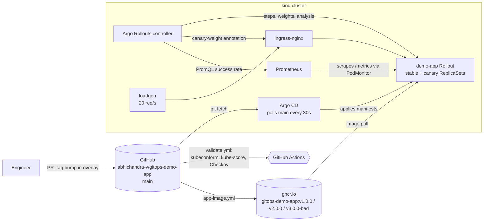
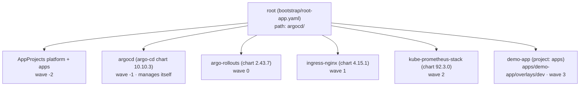
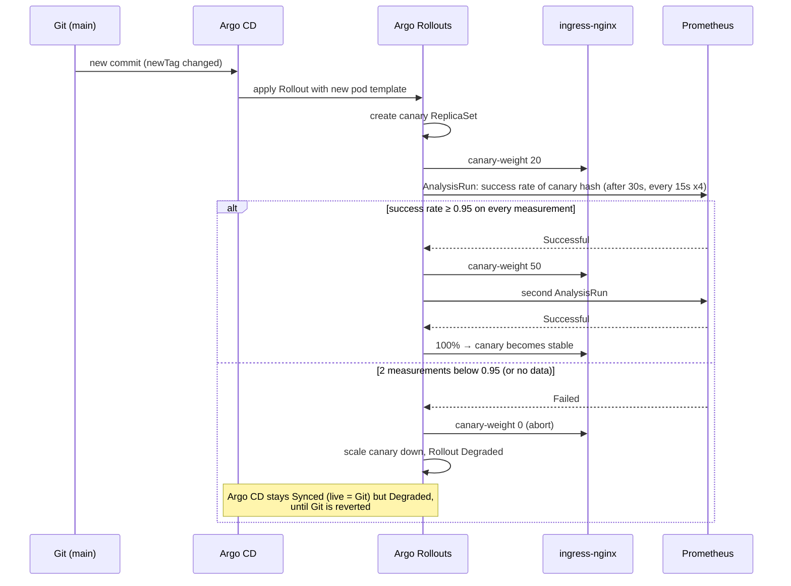

# Architecture

## Delivery path: repo → Argo CD → cluster

Nothing is applied to the cluster by hand after bootstrap. A release is a
commit that changes `newTag` in `apps/demo-app/overlays/dev/kustomization.yaml`;
a rollback is a commit that changes it back.

## App-of-apps tree

Platform apps use two sources: the pinned Helm chart and this repo as
`ref: values`, so `platform/<chart>/values.yaml` and the chart version change
in the same pull request. Waves wait for health because the `Application`
health check is restored in `argocd-cm` (ADR 0004).

## Canary flow with analysis

## Components

| Component | Responsibility | Why this choice |
|---|---|---|
| kind (1 control-plane, 2 workers) | Local Kubernetes v1.36.4 | Disposable, rebuilt from Git in minutes ([evidence](evidence/rebuild/cluster-rebuild-from-git.txt)) |
| Argo CD v3.5.5 | Reconciles the cluster to `main`; self-heals drift; manages its own Helm release | Pull-based: no cluster credentials in CI; Git is the audit log |
| Argo Rollouts v1.10.1 | Canary steps, traffic weights, analysis, abort | Progressive delivery as a Kubernetes resource Argo CD can sync |
| ingress-nginx 1.15.1 | Exact weight-based traffic split via canary Ingress | Weights don't depend on replica counts (ADR 0004, Phase 5 evidence) |
| kube-prometheus-stack (operator + Prometheus only) | Scrapes the demo app; answers the analysis query | `PodMonitor` carries the pod-template hash, so queries isolate the canary |
| demo-app (Go) | `/` version JSON, `/healthz`, `/metrics`; `v3.0.0-bad` fails ~40% of `/` | A bad release that passes probes, like most real ones |
| loadgen (fortio) | 20 req/s through the ingress | Analysis needs traffic; no data is treated as failure |
| GitHub Actions | `validate.yml` (schemas, kube-score, Checkov, chart render), `app-image.yml` (build + push images) | Catches broken manifests before Argo CD sees them |

## Trust boundaries

- `AppProject platform`: may create cluster-scoped resources, but only from
  four named repositories and into four namespaces.
- `AppProject apps`: this repo only, namespaces `demo-dev`/`demo-prod` only,
  no cluster-scoped resources except `Namespace`.
- The Argo CD admin password is never written to the repo; the bootstrap
  script prints the command to read it.

## Known limits

- One cluster and one environment (`dev`) are deployed; the `prod` overlay is
  rendered and validated in CI but not synced.
- Polling, not webhooks: 25–77s from push to Argo CD noticing in the recorded
  runs ([scenarios](case-study/SCENARIOS.md)).
- Single replicas of every controller; Prometheus retention 6h.
