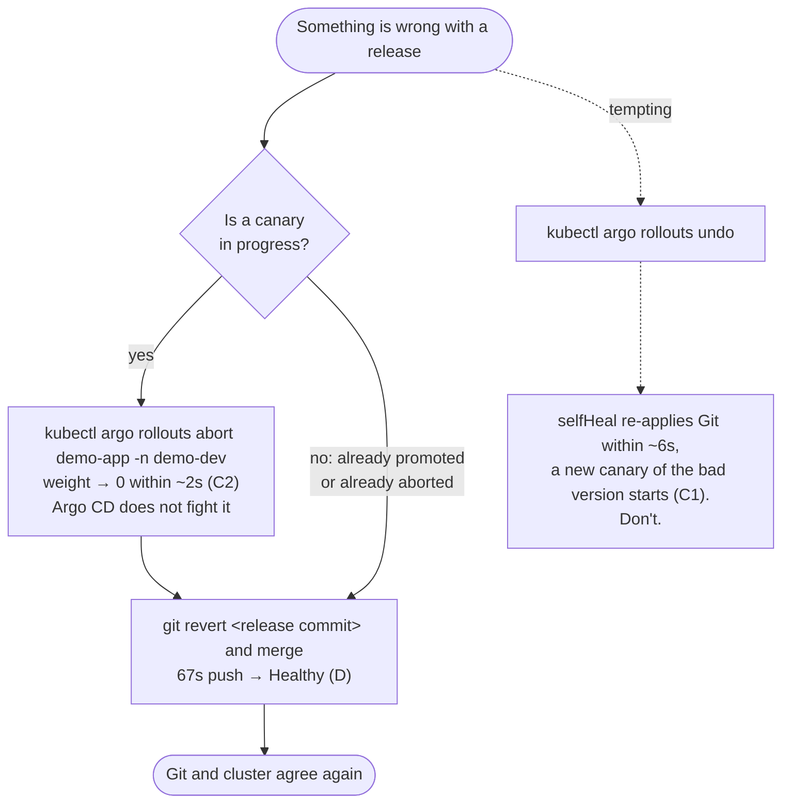

# Recovery runbook

Every time and behaviour below was observed in a recorded run; links point to
the evidence.

## Decision tree: abort vs undo vs git revert



| Action | Speed | Survives selfHeal? | Leaves Git correct? | Use when |
|---|---|---|---|---|
| Automatic abort (analysis) | 74s after push in B | Yes | No | Always on; nothing to do |
| `kubectl argo rollouts abort` | ~2s | Yes — status only, spec unchanged | No | A canary is live and you can't wait for analysis |
| `kubectl argo rollouts undo` | ~1s, then reverted | **No** — reverted in ~6s, bad canary restarts | No | Never with selfHeal on |
| `git revert` + push | 67s (62s of it polling) | Yes — it *is* the desired state | Yes | Always, as the actual fix |

Evidence: [B](evidence/scenario-b/bad-release-v2-to-v3-bad.txt) ·
[C1 undo](evidence/scenario-c/undo-with-selfheal.txt) ·
[C2 abort](evidence/scenario-c/abort-with-selfheal.txt) ·
[D revert](evidence/scenario-d/git-revert-bad-release.txt)

## Blast radius

- **Bad release, analysis on:** at most the 20% canary weight, for as long as
  the analysis takes to fail: ~45s after the canary pod was ready in B. In that
  run the canary served about 178 requests, 76 of them HTTP 500, out of about
  6,551 requests in the 5-minute window.
- **Bad release, analysis off or Prometheus down:** the analysis cannot pass on
  missing data (`len(result) > 0 && !isNaN(...)`) and Prometheus errors end the
  run as `Error`, so the release stops at 20% instead of promoting. Not
  exercised in a recorded run.
- **`undo` with selfHeal on:** the whole canary exposure repeats (C1).
- **Argo CD down:** no new releases, no self-heal, stale status; running
  workloads unaffected (F).

## Procedure: bad release in production

1. If a canary is live: `kubectl argo rollouts abort demo-app -n <ns>`.
2. Confirm users are on the stable version:

   ```bash
   kubectl argo rollouts get rollout demo-app -n <ns>
   curl -s -H 'Host: demo.localtest.me' 'http://localhost/?r=[1-50]' | grep -o '"version":"[^"]*"' | sort | uniq -c
   ```
3. `git revert <release commit>`, open a PR, merge (or push to `main` in an
   emergency).
4. Wait for `Synced / Healthy` (`bash scripts/status.sh`).
5. Keep the failed AnalysisRun output for the incident record.

## Procedure: drift (someone changed the cluster by hand)

Nothing to do while Argo CD is up: replicas 5 → 2 was reverted in 6s and an
image change in 4s ([E](evidence/scenario-e/)). To make a change that sticks,
make it in Git. Note that self-heal syncs do not appear in the Application's
`status.history`.

## Procedure: Argo CD is down

Observed in [F](evidence/scenario-f/argocd-down.txt):

1. Traffic is unaffected. Every 50-request sample still returned the current
   version with controller and server at 0.
2. Do not trust the Application status in this state; it showed
   `Synced/Healthy` while the live replica count had drifted to 3.
3. Bring back the **application controller** first:

   ```bash
   kubectl -n argocd scale sts argocd-application-controller --replicas=1
   ```

   It healed the drift and restored `argocd-server` on its own (Argo CD manages
   its own release): fully `Synced/Healthy` 21s later.
4. If Argo CD's own Helm release is broken, reinstall it from Git:
   `bash bootstrap/install-argocd.sh` (same values file the self-managed app
   uses), then `bash scripts/apply-root.sh`.
5. Releases during the outage: don't. If one is unavoidable,
   `kubectl argo rollouts` still works against the Rollout because the Rollouts
   controller is independent of Argo CD; reconcile Git afterwards.

## Procedure: rebuild the whole cluster from Git

```bash
make cluster-down
make cluster-up bootstrap
bash scripts/status.sh --wait 1200
```

Recorded run: see [rebuild evidence](evidence/rebuild/cluster-rebuild-from-git.txt)
for the measured time from an empty machine to all six Applications
`Synced/Healthy`, with images pulled from ghcr.io.

## Measured recovery times

| Situation | Action | Time to recovered | Evidence |
|---|---|---|---|
| Bad release reaches canary | automatic abort | 74s after push | [B](evidence/scenario-b/bad-release-v2-to-v3-bad.txt) |
| Git still names bad tag | `git revert` + push | 67s to `Synced/Healthy` | [D](evidence/scenario-d/git-revert-bad-release.txt) |
| Manual replica drift | selfHeal | 6s (spec), 14s (all pods ready) | [E](evidence/scenario-e/drift-replicas.txt) |
| Argo CD controller down | scale controller to 1 | 21s | [F](evidence/scenario-f/argocd-down.txt) |
